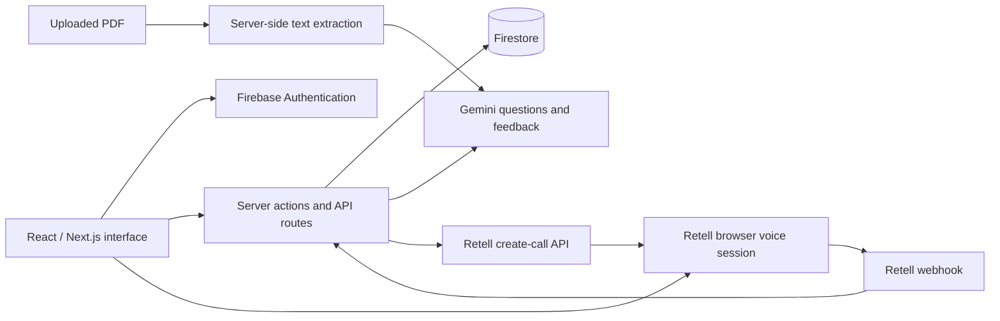

<div align="center">

# AI Mock Interview Platform

**Practice an interview. Review the feedback. Prepare the next attempt.**

`Next.js 15` · `React 19` · `TypeScript` · `Firebase` · `Gemini` · `Retell AI`

[Open demo](https://ai-mock-interview-roan-phi.vercel.app/sign-in) · [Quick start](#quick-start) · [Architecture](#architecture) · [Configuration](#configuration)

Maintained by [Kuvlay Naman](https://github.com/kuvlay)

</div>

---

A full-stack interview practice application with role-specific questions, voice sessions, stored feedback and PDF resume review. The public demo opens at sign-in; AI and voice features depend on configured external services.

## The experience

| Step | Implementation |
| --- | --- |
| **Choose the interview** | Select role, level, interview type and technologies to generate questions with Gemini |
| **Practice aloud** | Start a Retell voice session with call lifecycle handling |
| **Review the result** | View per-question feedback, overall scores and saved interview statistics |
| **Improve the resume** | Extract text from a PDF and request structured suggestions |

Firebase Authentication handles sign-in, server-side cookies manage sessions, and Firestore persists application records. Next.js server actions and API routes coordinate the backend.

## Architecture



The Firebase Admin SDK and provider keys are used on the server. Browser Firebase configuration is supplied through `NEXT_PUBLIC_FIREBASE_*` variables. [Architecture notes](ARCHITECTURE.md)

## Quick start

**Requirements:** Node.js 20, npm, a Firebase project, a Google Generative AI key, and configured Retell agents.

```bash
git clone https://github.com/kuvlay/ai_mock_interview.git
cd ai_mock_interview
npm ci
cp .env.example .env.local
```

Fill in `.env.local` using the configuration guide below, then start the app:

```bash
npm run dev
```

Open **http://localhost:3000**. The application needs valid service configuration before authenticated and AI flows can work.

## Configuration

| Variables | Purpose |
| --- | --- |
| `NEXT_PUBLIC_FIREBASE_*` | Browser Firebase SDK configuration; public values embedded at build time |
| `FIREBASE_PROJECT_ID`, `FIREBASE_CLIENT_EMAIL`, `FIREBASE_PRIVATE_KEY` | Server-only Firebase Admin credentials |
| `GOOGLE_GENERATIVE_AI_API_KEY` | Gemini question generation, feedback and resume review |
| `RETELL_API_KEY` | Server-only Retell API credential |
| `NEXT_PUBLIC_RETELL_AGENT_ID` | Agent used for interview generation |
| `NEXT_PUBLIC_RETELL_INTERVIEW_AGENT_ID` | Optional separate interview agent |

1. Enable Firebase email/password authentication and add the development or deployment domain to authorized domains.
2. Create the Firestore database and configure appropriate access rules for your application.
3. Provide Firebase Admin credentials. Preserve escaped `\n` line breaks in `FIREBASE_PRIVATE_KEY`.
4. Configure Retell agents and their webhook destination. The application exposes `/api/retell/create-call` and `/api/retell/webhook`.
5. Keep real credentials in local environment files or your deployment platform's secret configuration.

The [environment template](.env.example) lists the required variable names without real credentials.

## Build and deployment

```bash
npm run build
npm run start
```

Firebase browser values must be available during the Next.js build. Docker and Compose configurations are included, and the Docker Hub publishing workflow runs only when manually requested after provider credentials have been configured.

The existing `npm run lint` script calls `next lint`; it needs review against the installed Next.js tooling before use. No CI pass or successful deployment from a fresh clone is claimed by this README.

## Code map

| Path | Responsibility |
| --- | --- |
| `app/(auth)/` | Sign-in, sign-up and authentication layouts |
| `app/(root)/interview/` | Interview generation, sessions and feedback pages |
| `app/(root)/resume/` | PDF resume review interface |
| `components/AgentRetell.tsx` | Browser voice-session state and events |
| `app/api/retell/` | Create-call endpoint and webhook processing |
| `lib/actions/` | Authentication, interviews, feedback and resume actions |
| `firebase/` | Browser and Admin SDK initialization |

## Current scope

PDF review requires extractable text; scanned image-only PDFs are not supported by the text extraction path. Resume scores are model-generated suggestions rather than results from an employer's ATS. Provider quotas, voice-agent configuration and service availability affect AI features. Review authorization, webhook verification and resource limits before exposing a new deployment publicly.

<details>
<summary>Credits and license notes</summary>

Development attribution is retained in [project credits](PROVENANCE.md). The original README declares MIT but does not include a standalone license text. That declaration is preserved without adding a new copyright holder or granting a new license.

</details>
